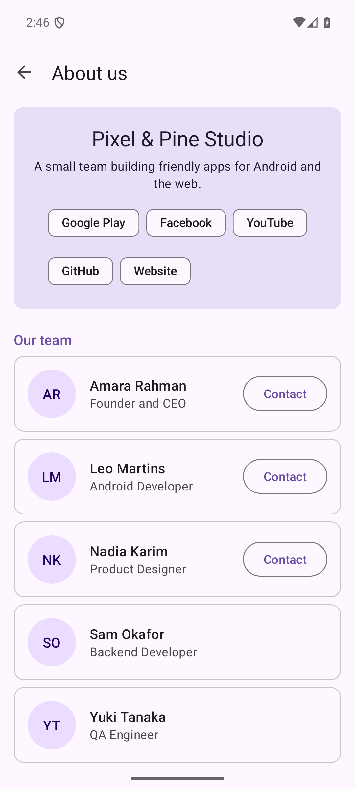
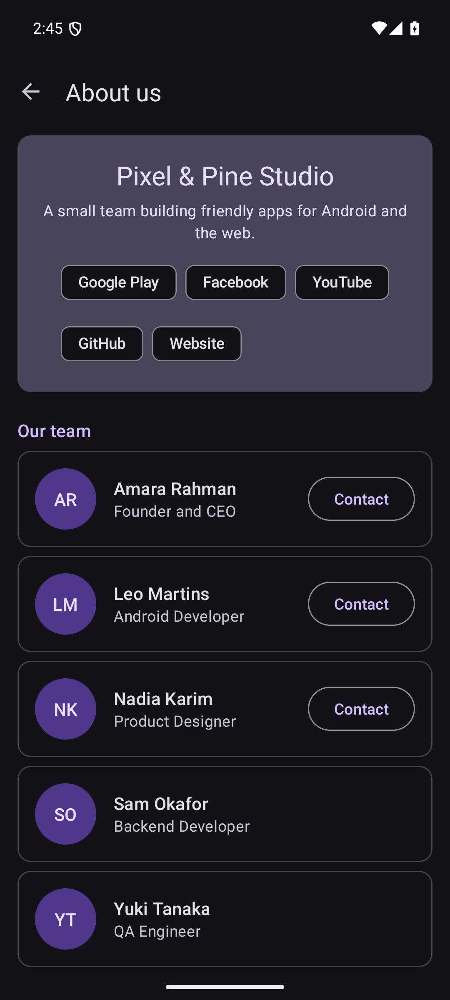

# OfficeAbout

A ready-made "About us" screen for Android apps made by a team. It shows your company name, logo, links and a card for every team member, all filled from one JSON file. You can host the JSON online and change the team without shipping an app update.

## Features

1. **Team cards:** photo (or initials when there is no photo), name, role and a Contact button.
2. **Company links** as chips: Google Play, Facebook page, community group, YouTube, GitHub and website. Links you leave empty are hidden.
3. **JSON from a URL or a string:** load it from the web, or from an asset in your app.
4. **Material 3, light and dark:** it follows the phone's dark mode, and you can give it your own colours.
5. **Loading and error states** with a Try again button.
6. **Small:** written in Kotlin with no image or JSON libraries. Works on Android 5.0 (API 21) and newer.

## Screenshots

 

## Install

1. Add JitPack to your repositories (in `settings.gradle.kts`):

```kotlin
dependencyResolutionManagement {
    repositories {
        google()
        mavenCentral()
        maven("https://jitpack.io")
    }
}
```

2. Add the dependency:

```kotlin
dependencies {
    implementation("com.github.p32929:OfficeAbout:2.0.0")
}
```

## Usage

Kotlin:

```kotlin
// From a JSON file you host
OfficeAboutHelper(this, "https://example.com/team.json").showAboutActivity()

// From a JSON string, for example an asset
val json = assets.open("team.json").bufferedReader().use { it.readText() }
OfficeAboutHelper.fromJson(this, json).showAboutActivity()
```

Java:

```java
new OfficeAboutHelper(this, "https://example.com/team.json").showAboutActivity();

OfficeAboutHelper.fromJson(this, json).showAboutActivity();
```

## JSON

Every field is optional. `officeName` and `about` are new in 2.0; the rest is the same as 1.x, so your old JSON still works.

```json
{
  "officeName": "Pixel & Pine Studio",
  "about": "A small team building friendly apps.",
  "officeLogoUrl": "https://example.com/logo.png",
  "googlePlayUrl": "https://play.google.com/store/apps/developer?id=Your+Name",
  "facebookPageUrl": "https://www.facebook.com/yourpage",
  "facebookPageID": "104754327537968",
  "groupUrl": "https://www.facebook.com/groups/yourgroup/",
  "youtubeUrl": "https://www.youtube.com/@yourchannel",
  "githubUrl": "https://github.com/you",
  "webUrl": "https://example.com",
  "members": [
    {
      "imageUrl": "https://example.com/amara.jpg",
      "name": "Amara Rahman",
      "post": "Founder and CEO",
      "contactUrl": "mailto:amara@example.com"
    }
  ]
}
```

If `facebookPageID` is set and the Facebook app is installed, the Facebook chip opens the page in the app.

## Your own colours

The screen uses the theme `Theme.OfficeAbout` (Material 3, DayNight). To use your colours, define a style with the same name in your app:

```xml
<style name="Theme.OfficeAbout" parent="Theme.Material3.DayNight.NoActionBar">
    <item name="colorPrimary">@color/your_primary</item>
</style>
```

The title and labels are normal string resources (`office_about_title`, `office_about_team`, `office_about_contact` and others), so you can change or translate them the same way.

## Migrating from 1.x

1. The two lines you used before still work: `new OfficeAboutHelper(context, url)` and `showAboutActivity()`.
2. Your JSON still works without changes.
3. The library now needs Android 5.0 (API 21) or newer, and an app built with a recent Android Gradle Plugin.
4. `OfficeInfo` and `Member` are plain Kotlin classes now. They are no longer `Parcelable`, but their getters and setters have the same names.
5. The internal classes `OfficeAboutLoader`, `MembersListener`, `GlobalMethods` and `AboutRecyclerviewAdapter` were removed.
6. Picasso, Gson and CircleImageView are no longer pulled into your app.
7. You no longer need a ProGuard rule; the library ships its own.

## Sample app

The `app` module opens the screen with a sample team from `app/src/main/assets/team.json`, or from a JSON URL.

## License

MIT License — Copyright (c) 2019 Fayaz Bin Salam. See [LICENSE](LICENSE) for the full text.

## Contributing

Contributions are warmly welcomed and greatly appreciated! Whether it's a bug fix, new feature, or improvement, your input helps make this project better for everyone.

Before submitting a pull request, please:

1. Create an issue describing the feature or bug fix you'd like to work on
2. Wait for discussion and approval to ensure alignment with project goals
3. Fork the repository and create your feature branch
4. Submit your pull request with a clear description of changes

This approach helps avoid duplicate efforts and ensures smooth collaboration. Thank you for considering contributing!

## Share

Sharing this repository with your friends is just one click away from here

[](https://www.facebook.com/sharer/sharer.php?u=https://github.com/p32929/OfficeAbout/)
[](https://twitter.com/intent/tweet?url=https://github.com/p32929/OfficeAbout/)
[](https://www.tumblr.com/share?v=3&u=https://github.com/p32929/OfficeAbout/)
[](https://getpocket.com/save?url=https://github.com/p32929/OfficeAbout/)
[](https://pinterest.com/pin/create/button/?url=https://github.com/p32929/OfficeAbout/)
[](https://www.reddit.com/submit?url=https://github.com/p32929/OfficeAbout/)
[](https://www.linkedin.com/shareArticle?mini=true&url=https://github.com/p32929/OfficeAbout/)
[](https://api.whatsapp.com/send?text=https://github.com/p32929/OfficeAbout/)

---

## Support

If this saved you time, you can buy me a coffee — it keeps these projects maintained and free. Other payment options: https://p32929.github.io/SendMoney2MeV1/

[](https://www.buymeacoffee.com/p32929)

<!-- hire-block -->

---

## 💼 Using this at a company?

I do fixed-price delivery work on my own projects. One invoice, one date, no hourly billing:

| | |
|---|---|
| **White-label build** — this project rebranded, extended and deployed as yours | **$6,500** · 3 weeks |
| **Custom app from scratch** on my own stack, signed and auto-updating | **$12,500** · 6 weeks |
| **Production-hardening sprint** — 72 hours on this project, for your load and your security review | **$999** |
| **Ongoing capacity** — one project-week of my time reserved every month | **$9,000 / month** |

Full details → **[p32929.github.io/hire](https://p32929.github.io/hire/)** · Email **[fayazdevinbox@uberip.com](mailto:fayazdevinbox@uberip.com)** — scoping and quotes are free and I answer within one business day.
